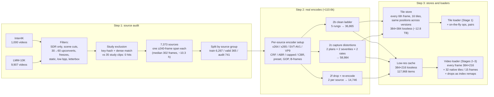
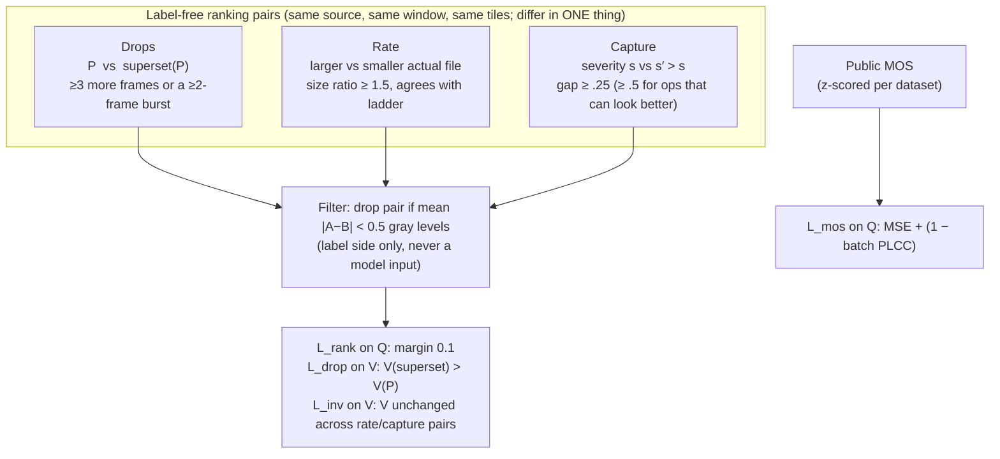
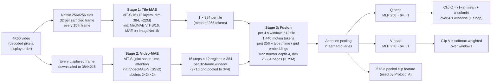
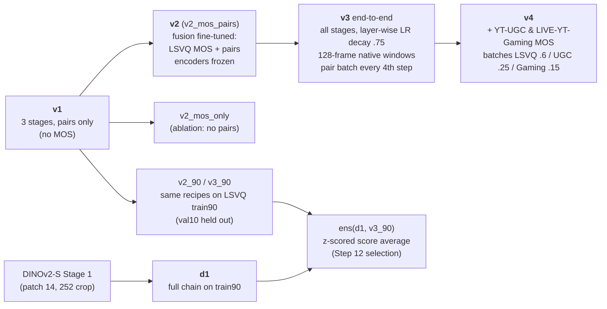
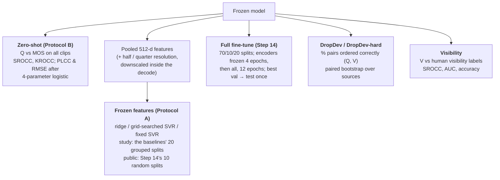
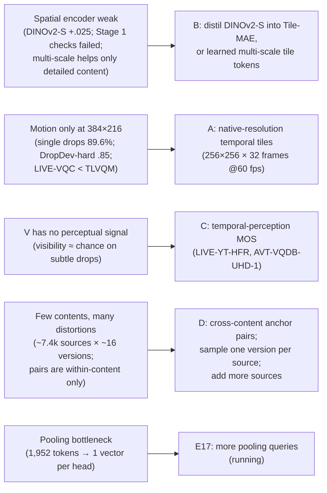

# FrameDrop-VQA: a pixels-only, real-time 4K60 quality model with frame-drop visibility

**Status report, 2026-10-23.** This covers the data pipeline, the model, every experiment run so far, and every PLCC/SROCC result.

> **Data-use rule:** the FrameDrop-VQA subjective study (1,823 videos, 35 contents, 4K60) is never used for training, tuning or checkpoint selection.
> - The one exception: per-split fine-tuning, marked "trained" in the tables.
> - Every scoring run on the study is logged in [`results/study_eval_log.csv`](results/study_eval_log.csv): 18 evaluations to date (§7).

---

## Contents
1. [Summary](#1-summary)
2. [Data pipeline](#2-data-pipeline)
3. [Supervision: what the model learns from](#3-supervision-what-the-model-learns-from)
4. [Model](#4-model)
5. [Model versions and training](#5-model-versions-and-training)
6. [Evaluation protocols](#6-evaluation-protocols)
7. [Experiments, in order](#7-experiments-in-order)
8. [Consolidated results](#8-consolidated-results)
9. [Speed](#9-speed)
10. [What we learned and next steps](#10-what-we-learned-and-next-steps)
11. [Repository layout](#11-repository-layout)

---

## 1. Summary

The model reads only decoded pixels in display order. It outputs two scores:
- **Q:** overall quality.
- **V:** how visible the frame drops are.

It is trained mostly from **label-free pair order** ("more drops / lower bitrate / stronger capture distortion is worse") on 110k real encodes of 7,373 clean 4K60 sources. Public MOS (LSVQ, and in v4 YouTube-UGC and LIVE-YT-Gaming) adds an absolute quality scale.

| Result (SROCC / PLCC) | Ours | Best baseline |
|---|---|---|
| Study, **zero-shot** | **v4: .816 / .805** | UVQ1.5: .770 / .774 |
| Study, frozen features + SVR (20 grouped splits) | v4, 3-scale: .845 / .842 | GAMIVAL: .886 / .884 |
| Study, full fine-tune (20 grouped splits) | v3: .923 / .918 | not run for baselines (not matched) |
| Study, frame-drop visibility (AUC "noticed") | v4: .649 | FasterVQA .517; VLMs ≈ .50 |
| KoNViD-1k / LIVE-VQC / YT-UGC, frozen features + SVR | .837 / .776 / .792 | TLVQM .768 / **.803** / .659 |
| KoNViD-1k / LIVE-VQC / YT-UGC, full fine-tune | .848 / .821 / .829 | HFVQA .927 / .915 / .921 |
| LSVQ test / 1080p, trained on LSVQ | v3: .851 / .726 | HFVQA .906 / .873 |
| DropDev-hard, drop ordering (Q / V) | v4: .851 / .922 | n/a (benchmark is ours) |

---

## 2. Data pipeline



**Step 1, source audit.**
- Each clip is checked for HDR, scene cuts, 30→60 upconverted cadence, native freezes, static content, low bits-per-pixel and letterboxing.
- Each kept source has one usable span of ≥ 240 frames.
- Sources are grouped (same shoot, or duplicates across datasets) and split by group: train / valid / audit. The audit split is used only for the DropDev benchmarks (§3).

**Step 2, real encodes.**
- **One encoder setup per source:** each source gets one randomly sampled setup, reused for all of its versions, so any two versions differ along exactly one axis.
- **Compression is never simulated.** All of it comes from real encoders.
- **Capture plans:** each plan has 1–3 ops from a 32-op bank (blur, noise, banding, ghosting, shutter, colour and others), rendered at severities 0.5 and 1.0.
- **2f re-encodes:** drops are applied first, then the clip is re-encoded at a random CRF, so held frames are near-identical rather than exact copies, as in real streams.

**Frame drops** are applied on the fly as index remaps on the display timeline:
- **Families:** burst (1–60-frame runs), Bernoulli (p .03–.7), Gilbert–Elliott, pacing (every m-th frame, m 2–6), two-family mixtures (12%) and none (8%).
- **Typical amount:** the median dropped fraction is about 12%.

**Public MOS sets** are used at native resolution and frame rate, never upscaled.

| Dataset | Clips | Used for |
|---|---|---|
| LSVQ train | 28,056 | MOS training (v2, v3, v4); a 90/10 split (train90 / val10) for selection |
| LSVQ test / 1080p | 7,180 / 3,567 | evaluation only |
| KoNViD-1k | 1,200 | evaluation; Step 14 per-split fine-tune |
| LIVE-VQC | 585 | evaluation; Step 14 per-split fine-tune |
| YouTube-UGC (CRF-10 H.264, MOS available) | 977 | v4 training (split-0 train, 684); Step 14 fine-tune |
| LIVE-YT-Gaming | 600 (430 train / 109 val / 61 excluded) | v4 training; the 5 titles shared with the study are excluded |

---

## 3. Supervision: what the model learns from



- **Pairs never compare different axes** (e.g. drops vs bitrate), and never different sources. Only MOS ties the axes together and sets the level across contents.
- **Development benchmarks** come from audit sources only, never the study:
  - **DropDev:** 17,784 pairs of 4 types (burst length, burst count, random density, none vs some), half of them re-encoded. Saturated (~.96).
  - **DropDev-hard:** the same types with subtler gaps: bursts ≤ 6 frames, k vs k+1 bursts, density gaps of .03–.08, and re-encodes from the high end of the CRF range.

---

## 4. Model



| Stage | Pretraining objective in this project | Training size |
|---|---|---|
| 1. Tile-MAE | MAE reconstruction, 75% mask; targets are normalised pixels + per-patch mean/std. Rank loss on rate/severity tile pairs (weight .1). | 100k steps × 516 tiles, 3×A100, average of the last 4 checkpoints |
| 2. Video-MAE | MAE with whole-time-step masking (50% of steps, then 50% of the remaining tokens), so held frames must be predicted from their neighbours. Rank loss on drop pairs (weight .1). | 100k steps × 66 windows, 3×A100, average of the last 4 checkpoints |
| 3. Fusion | L_rank + L_drop + 0.1 L_inv; plus L_mos from v2 on | see §5 |

**Hard rules** (all versions):
- **Pixels only:** no timestamps, codec, bitstream or frame-difference statistics, and never the injected parameters.
- **Allowed position information:** frame order within the window and tile/region position only.
- **No name or order leaks:** tile positions use a fixed seed, never one derived from file names.

---

## 5. Model versions and training



| Version | What is trained | Data | Steps (epochs) |
|---|---|---|---|
| v1 | fusion only (encoders frozen) | 60k synthetic pairs | 30k × 16 pairs (8 epochs) |
| v2 | fusion, from v1 | LSVQ train + pairs, alternating batches | 20k (5.7 LSVQ epochs) |
| v2_mos_only | fusion, from v1 | LSVQ only | 10k |
| v3 | all stages, from v1 encoders + v2 fusion | LSVQ train + pairs decoded on the fly | 12k (2.6 LSVQ epochs) |
| v2_90 / v3_90 | as v2 / v3 | LSVQ train90 | as above |
| d1 | Stage 1 from DINOv2-S, then the full chain | train90 | 50k (Stage 1) + chain |
| v4 | all stages, from v3 | LSVQ + YT-UGC split-0 train + Gaming train | 6k (0.8 LSVQ, 13 UGC, 12.6 Gaming epochs) |

---

## 6. Evaluation protocols



- **Ground truth:** study MOS and visibility come from `mos_visibility_per_video.csv`, the subject-screened MOS plus the distribution over 4 visibility grades.
- **Older evals:** evals 1–5 used an earlier MOS file, and their numbers are not directly comparable. The v3 rescore (eval 11) puts v3 on the current ground truth.

---

## 7. Experiments, in order

Each block gives the question, what was done, and the result. **Bold** marks the outcome the next step built on.

### E1: v1, three stages trained with pairs only (no MOS)
- **Synthetic validation:** Q orders drops / rate / severity at 99.7 / 99.9 / 96.8%; V orders drops at 100%.
- **Zero-shot:** study SROCC .640, KoNViD .434.
- **Within-content ordering on the study:** median SROCC .913.
- **Diagnosis:** the model ranks versions of the same content well, but its score level shifts between contents. Nothing in pair-only training sets a scale across contents.
- **Failed checks:** Stage 1 reconstruction error does not rise with severity, and Stage 1 features have low spread (std .097). In Stage 2, the "catch-up frame" check failed, and single-frame drops are ordered correctly only 89.6% of the time.

### E2: v2, add LSVQ MOS to the fusion (encoders frozen)
| | v1 | **v2 (MOS + pairs)** | v2_mos_only |
|---|---|---|---|
| LSVQ test SROCC / PLCC | .296 / .334 | **.832 / .831** | .832 / .830 |
| LSVQ 1080p | .405 / .479 | **.699 / .742** | .703 / .737 |
| KoNViD-1k | .434 / .439 | **.816 / .812** | .814 / .810 |
| Study (old MOS) | .640 / .635 | **.738 / .727** | .741 / .730 |
| Study: consecutive drops ordered by Q | 94.6% | 88.3% | **75.2%** |

**Pairs are needed:** without them, MOS-only training loses drop ordering (88% → 75%).

### E3: v3, end-to-end fine-tune of all stages
- **Public MOS:** about +.02 SROCC on every set: LSVQ test **.851**, 1080p **.726**, KoNViD **.838**.
- **Study:** .745 on the old MOS, .767 / .757 on the current one.
- **Drop ordering got worse** (study consecutive drops 88% → 82%).

### E4: DropDev benchmark and the v2-vs-v3 gate
- **Purpose:** check on development data, not the study, whether v3 really orders drops worse than v2.
- **Result:** DropDev Q v2 .9646 vs v3 .9631; the difference CI [−.001, .004] includes 0, so **not reproduced**.
- **Benchmark saturation:** base DropDev is saturated (~.96), which motivated DropDev-hard.

### E5: DropDev-hard
- **Design:** fixed in advance, before any model was scored, with subtler drop patterns.
- **Scores:** Q ordering ranges from .787 (v2_mos_only) to .875 (d1). The v2–v3 gap still isn't reproduced.
- **Use:** it became the main development signal for drop sensitivity.

### E6: backbone probe (ridge on frozen tile features, LSVQ val10 / KoNViD)
| Backbone | val10 SROCC | KoNViD SROCC | Time per 10 s 4K60 clip |
|---|---|---|---|
| ours (v1 Stage 1) | .736 | .726 | 0.24 s |
| ours (v3 Stage 1) | .762 | .748 | 0.24 s |
| **DINOv2-S** | **.787** | **.771** | 0.29 s |
| DINOv2-B | .786 | .770 | 0.65 s |
| DINOv2-L | .788 | .747 | 1.84 s |

**Model size doesn't help; the pretraining does.** DINOv2-S beats our Tile-MAE by about .025.

### E7: d1, the full chain with a DINOv2-S Stage 1
- **Development (LSVQ val10):** .843, against .831 for v2_90.
- **Study zero-shot:** .773 / .763, the first result above UVQ1.5 on SROCC (eval 8).
- **Frozen features + regressor:** weaker (ridge .742).

### E8: Step 12 selection rule and ensemble
- **The rule** was fixed before any number existed: best LSVQ val10, with a DropDev tie-break.
- **Candidates (val10 / DropDev Q):** ens(d1, v3_90) **.853** / .973 *(selected)*; v3_90 .851 / .954; ens(d1, v2_90) .845 / .974; d1 .843 / .970; v2_90 .831 / .960.
- **Selected ensemble on the study:** .768 / .758, below UVQ1.5 (eval 9).
- **Frozen-feature regressor on the ensemble's concatenated features:** .842. Each member alone gives .742 and .781 (eval 10).

### E9: does 10 fps sampling miss 60 fps drops? (model-free check)
- **Result:** at 10 fps, the better and worse clip of a pair show **identical** frames for 11.8% of DropDev pairs and **52.0%** of DropDev-hard pairs. That is 75% of the burst-count pairs.
- **Why it matters:** methods that sample 10 fps (e.g. HFVQA) cannot see most short drops. Every-frame processing is a real differentiator for us.

### E10: Step 14, full fine-tuning per dataset (HFVQA Protocol 2)
Starting from v3: 70/10/20 splits, encoders frozen for 4 epochs, then all trained, 12 epochs; best validation epoch, then test once.

| Dataset (splits) | Ours v3 SROCC / PLCC | HFVQA | DOVER | BVQA |
|---|---|---|---|---|
| KoNViD-1k (10) | .848 / .845 | .927 / .926 | .899 / .897 | .836 / .834 |
| LIVE-VQC (10) | .821 / .834 | .915 / .905 | .852 / .812 | .842 / .831 |
| YouTube-UGC (10) | .829 / .804 | .921 / .919 | .873 / .877 | .819 / .831 |
| **Study (20, baselines' splits)** | **.923 / .918** | n/a | n/a | n/a |

On the study, this compares with GAMIVAL .886, but GAMIVAL only trains an SVR on fixed features, so the comparison is **not matched**. A matched full fine-tune of DOVER and FasterVQA was planned, then cancelled (E16).

### E11: v4, more MOS data (YouTube-UGC + LIVE-YT-Gaming)
| | v3 | **v4** |
|---|---|---|
| YT-UGC split-0 test / Gaming val (in-domain) | .688 / .660 | **.792 / .693** |
| LSVQ test / 1080p | **.851 / .726** | .843 / .714 |
| KoNViD-1k / LIVE-VQC | **.838 / .699** | .829 / .664 |
| DropDev-hard Q / V | .840 / .912 | **.851 / .922** (significant) |
| **Study zero-shot SROCC / PLCC / RMSE** | .767 / .757 / .418 | **.816 / .805 / .380** |
| Study, frozen features: ridge / SVR | .792 / .799 | **.838 / .827** |

- **v4 is the first model to beat every zero-shot baseline on the study.**
- **Cost:** it loses .01–.035 on public sets it never saw.
- **Caveat:** the study was used to choose between v3 and v4, so it now counts as a selection set.

### E12: frame-drop visibility vs human labels
- **Label:** the majority vote of the four human grades (Not / Barely / Slightly / Clearly noticeable). Grade counts are 687 / 252 / 144 / 740.
- **Accuracy:** uses cut-points on V learned by grouped 5-fold cross-validation (10 seeds), so every video is predicted exactly once.

| Method | 4-class accuracy | Noticed vs not: accuracy / AUC | Clearly vs rest: accuracy / AUC |
|---|---|---|---|
| *Chance* | *.406* | *.623 / .500* | *.594 / .500* |
| d1 | .482 | .624 / .626 | .677 / .609 |
| v3 | .474 | .629 / .639 | .676 / .621 |
| **v4** | .467 | .625 / **.649** | .674 / **.632** |
| DOVER (quality score) | .419 | .626 / .513 | .588 / .558 |
| FasterVQA (quality score) | .395 | .622 / .517 | .589 / .529 |
| InternVL3-8B (direct answer) | .376 | .377 / .499 | .592 / .499 |
| InternVideo3-8B (direct answer) | .227 | .552 / .493 | .529 / .485 |

- **All methods are weak.** Ours is the only one above chance on AUC, and middle grades are almost never predicted correctly.
- **The VLMs are blind to timing.** Their own control tests show this: a 100%-frozen or shuffled clip still gets "None noticeable".

### E13: our features + GAMIVAL scene-statistics features *(explored, then dropped)*
Run on 20 splits with SVR: v4 alone .827; GAMIVAL scene statistics alone .723; concatenated **.873 / .861**. **Dropped by decision:** results must come from our model alone, without hand-crafted features.

### E14: multi-scale frozen features on the study (downscale inside the decode, no re-encode)
| Features (v4) | Ridge SROCC / PLCC | Grid-searched SVR SROCC / PLCC | Fixed SVR SROCC / PLCC |
|---|---|---|---|
| full (512) | .838 / .823 | .827 / .824 | .826 / .827 |
| half (512) | .840 / .824 | .836 / .827 | .832 / .823 |
| quarter (512) | .740 / .717 | .734 / .740 | .743 / .739 |
| full + half (1024) | .838 / .827 | .844 / .841 | .846 / .841 |
| **full + half + quarter (1536)** | **.844 / .835** | **.845 / .842** | **.848 / .842** |

- **Gain:** a second scale adds about .02. A third adds little, though consistently: it wins on 14–17 of 20 splits.
- **Ceiling:** about .845, still below GAMIVAL's .886.

### E15: multi-scale frozen features on public sets (v3; Step 14 splits; train+val → test)
| Dataset | Features | Ridge | Grid-searched SVR | Fixed SVR | TLVQM / VIDEVAL (features + SVR) |
|---|---|---|---|---|---|
| KoNViD-1k | native | .837 / .830 | .837 / .836 | .834 / .837 | .768 / .780 |
| | native + half | **.838 / .835** | .832 / .834 | .834 / .835 | |
| LIVE-VQC | native | .777 / .795 | .776 / .781 | .728 / .746 | **.803** / .751 |
| | native + half | **.781 / .804** | .775 / .783 | .723 / .732 | |
| YouTube-UGC | native | .758 / .748 | .759 / .742 | .753 / .734 | .659 / .773 |
| | native + half | .778 / .757 | **.792 / .763** | **.792 / .766** | |

- **Multiple scales only help YouTube-UGC,** whose sources range from 360p to 4K.
- **Against hand-crafted baselines:** we beat them on KoNViD-1k and YouTube-UGC. On LIVE-VQC we lose to TLVQM, whose motion features suit its camera shake.

### E16: full fine-tuning of DOVER / FasterVQA on the study *(cancelled)*
- **Purpose:** a matched baseline for E10, run on the same splits with each repo's own recipe.
- **Status:** cancelled after the smoke test, to focus on improving our own backbone.

### E17: attention-pooling bottleneck *(running)*
- **Question:** each window's 1,952 tokens are reduced to one query vector per head. Does that limit the model?
- **Variants:** the fusion is retrained with **1 / 4 / 8 pooling queries per head**, using v2_90's recipe with v1 encoders frozen.
- **Selection:** development data only (LSVQ val10, DropDev, DropDev-hard). Results will be added here.

---

## 8. Consolidated results

### 8.1 FrameDrop-VQA study vs official baselines (1,823 videos)
| Method | Protocol | PLCC | SROCC | KROCC | RMSE |
|---|---|---|---|---|---|
| **Ours v3, full fine-tune** | trained (20 splits) | .918 | .923 | .759 | .263 |
| GAMIVAL (SVR) | trained (20 splits) | .884 | .886 | .702 | .317 |
| GAMIVAL (LinearSVR) | trained | .850 | .846 | .650 | .362 |
| **Ours v4, 3-scale frozen features + SVR** | trained (20 splits) | .842 | .845 | .651 | .362 |
| **Ours v4, frozen features + ridge** | trained (20 splits) | .823 | .838 | .634 | .374 |
| **Ours v4** | **zero-shot** | **.805** | **.816** | .613 | .380 |
| VIDEVAL | trained | .775 | .770 | .577 | .417 |
| UVQ1.5 | zero-shot | .774 | .770 | .565 | .406 |
| Ours d1 | zero-shot | .763 | .773 | .568 | .414 |
| Ours v3 | zero-shot | .757 | .767 | .564 | .418 |
| RAPIQUE (SVR) | trained | .731 | .744 | .542 | .532 |
| GAME-VQP | trained | .690 | .687 | .493 | .503 |
| DOVER | zero-shot | .687 | .672 | .482 | .465 |
| FAST-VQA | zero-shot | .645 | .643 | .454 | .490 |
| nr-vqa-consumervideo | trained | .630 | .626 | .450 | .711 |
| NIQE / BRISQUE | opinion-unaware | .596 / .558 | −.574 / −.567 | | |
| P.1204.3 | zero-shot | .255 | −.274 | | .620 |
| InternVideo3-8B / InternVL3-8B | zero-shot | .232 / .169 | .194 / −.075 | | |

### 8.2 Public sets, HFVQA Table 1 layout (SROCC / PLCC)
| Method | LSVQ test | LSVQ 1080p | KoNViD (cross) | LIVE-VQC (cross) | KoNViD (FT) | LIVE-VQC (FT) | YT-UGC (FT) |
|---|---|---|---|---|---|---|---|
| TLVQM | .774 / .772 | .616 / .589 | .724 / .732 | .691 / .670 | .768 / .773 | .803 / .799 | .659 / .669 |
| VIDEVAL | .783 / .794 | .554 / .545 | .741 / .751 | .640 / .630 | .780 / .783 | .751 / .752 | .773 / .779 |
| BVQA | .854 / .852 | .782 / .771 | .837 / .834 | .824 / .816 | .836 / .834 | .842 / .831 | .819 / .831 |
| FAST-VQA | .874 / .872 | .809 / .770 | .862 / .864 | .841 / .824 | .889 / .890 | .852 / .845 | .853 / .857 |
| DOVER | .879 / .881 | .827 / .782 | .872 / .871 | .841 / .812 | .899 / .897 | .852 / .812 | .873 / .877 |
| HFVQA | .906 / .903 | .873 / .842 | .891 / .893 | .862 / .856 | .927 / .926 | .915 / .905 | .921 / .919 |
| **Ours v3** (LSVQ only) | .851 / .850 | .726 / .767 | .838 / .834 | .699 / .752 | .848 / .845 | .821 / .834 | .829 / .804 |
| Ours v4† | .843 / .841 | .714 / .759 | .829 / .830 | .664 / .728 | | | n/a |

† v4 also trained on YT-UGC and LIVE-YT-Gaming train splits, so it is not LSVQ-only.

### 8.3 Drop ordering on development benchmarks (Q / V accuracy)
| Model | DropDev (16,020 pairs) | DropDev-hard (15,496 pairs) |
|---|---|---|
| v1 | .966 / .989 | .854 / .925 |
| v2 | .965 / .989 | .844 / .925 |
| v2_mos_only | .942 / .985 | .787 / .898 |
| v3 | .963 / .987 | .841 / .913 |
| d1 | **.971** / .987 | **.875** / .910 |
| **v4** | .964 / .988 | .851 / .922 |

### 8.4 Study evaluations to date
There have been 18 logged evaluations: zero-shot scoring runs, frozen-feature runs, visibility re-scores and the multi-scale runs. The full list, with the model, what changed and the ground-truth file for each, is in [`results/study_eval_log.csv`](results/study_eval_log.csv).

---

## 9. Speed
Measured on one A100-40GB with real 4K60 clips, bf16:

| Measure | Throughput | × real time |
|---|---|---|
| Model only: tiles + motion + fusion, incl. host→device copies (v3) | ≈ 1,974 fps | 33× |
| End to end, 1 stream (NVDEC + CPU downscale/crops + GPU) | 75–112 fps | 1.3–1.9× |
| End to end, 16 decode processes into 1 GPU | ≈ 300–900 fps | 5–15× |

Decoding and CPU-side resizing take more than 90% of single-stream time. Moving the resize and crops onto the GPU is the obvious next speed-up. AV1 has no NVDEC support on A100.

---

## 10. What we learned and next steps



1. **(A) High-resolution temporal branch.** This is the largest expected gain on drops, visibility and DropDev-hard, and no baseline sees 60 fps at native resolution.
2. **(B) Better spatial encoder.** Distil DINOv2-S into the Tile-MAE, or add learned multi-scale tile tokens.
3. **(C) Temporal-perception MOS data,** to give V a human signal.
4. **(D) Content diversity.** Add cross-content pairs, sample one version per source per visit, and add more sources.
5. **Selection hygiene.** Choose the next model on development data only (LSVQ val10, DropDev / DropDev-hard, held-out public splits), then evaluate it on the study **once**.

---

## 11. Repository layout
```
README.md                     this report
results/
  study_eval_log.csv          every study evaluation (model, what changed, metrics, ground truth)
  baselines_framedrop_vqa.csv official FrameDrop-VQA baseline table
  step14_finetune_results.csv per-split full fine-tune results (KoNViD, LIVE-VQC, YT-UGC, study)
  step18_multiscale_*.json    study multi-scale Protocol A summaries
  step19_public_summary.json  public multi-scale Protocol A summary
  dropdev_*.json              DropDev / DropDev-hard metrics per model
code/                         all step scripts (Steps 1–20); no data, tokens or weights
  METHOD_PLAN.md              original plan and step briefs
  METHODOLOGY_20261023.md     method write-up and ranked improvement options
```
The code expects the cluster paths used during the project (`/scratch/.../FrameDrop-VQA`). Data, tokens and checkpoints are not included.
