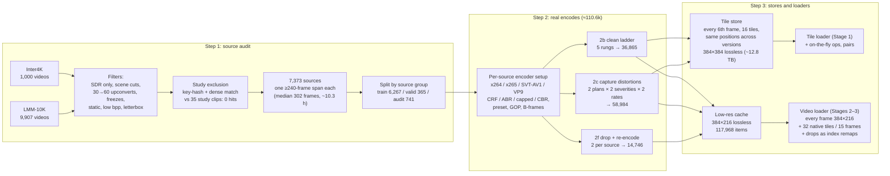
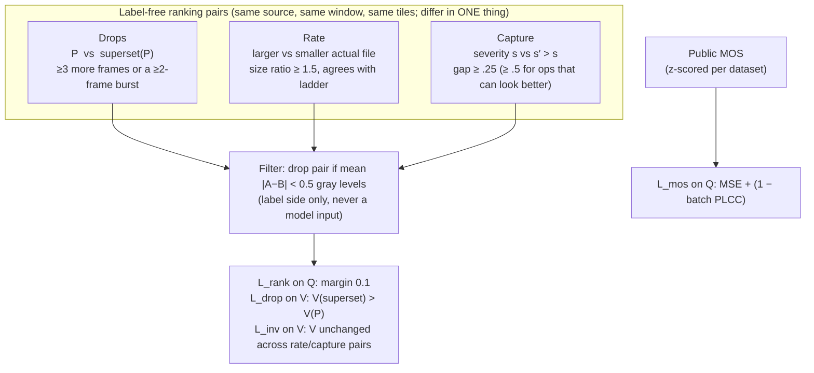
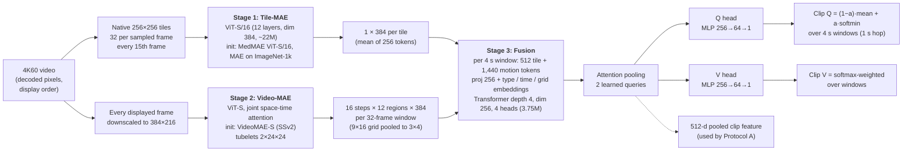
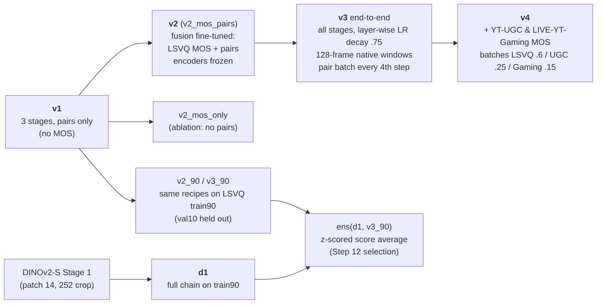
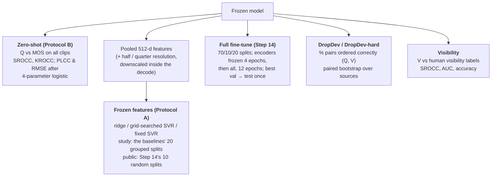
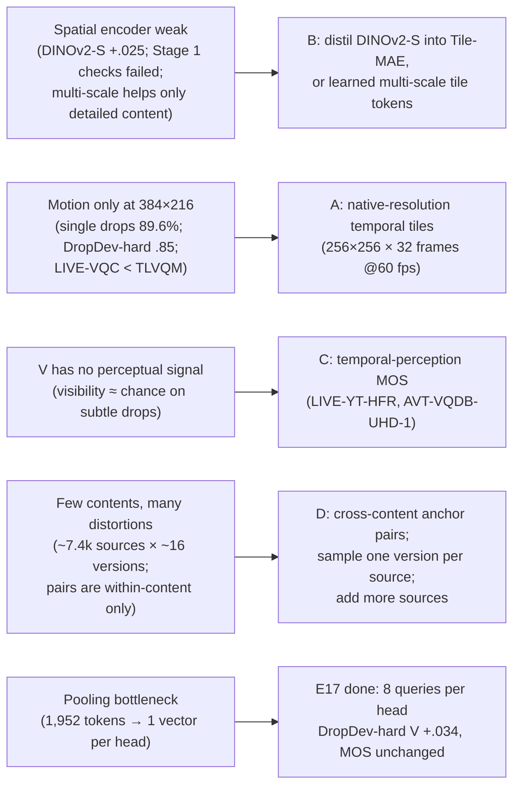

# FrameDrop-VQA: a pixels-only, real-time 4K60 quality model with frame-drop visibility

**Status report, 2026-10-23.** This covers the data pipeline, the model, every experiment run so far, and every PLCC/SROCC result.

> **Update 2026-11-06 (all experiments):** one table with every public-set result so far (params and inference FLOPs included) vs MVQA, and one section per row explaining how that model was trained and evaluated: [`results/PUBLIC_2026-11-06_ALL.md`](results/PUBLIC_2026-11-06_ALL.md).

> **Update 2026-11-06:** one table of everything so far, from raw public encoders to our best models, vs MVQA, with what each row is and what it shows: [`results/PUBLIC_2026-11-06.md`](results/PUBLIC_2026-11-06.md).

> **Update 2026-11-04:** our synthetic data (no human labels) makes public VideoMAE-v2-S better at quality on every public set (+.03 to +.08 SRCC), plus VideoMAE-v2-B probes and full training details: [`results/PUBLIC_2026-11-04.md`](results/PUBLIC_2026-11-04.md).
>
> **Update 2026-11-03:** public-set table with motion48 added, a probe of whether our motion encoder (S2) helps on top of DINOv2, and a VideoMAE-v2-S motion-feature probe: [`results/PUBLIC_2026-11-03.md`](results/PUBLIC_2026-11-03.md).
>
> **Update 2026-11-02:** new public-set results (DINOv2-S and Tile-MAE models, LSVQ-trained) against the HFVQA Table 1 baselines, with training and evaluation written out: [`results/PUBLIC_2026-11-02.md`](results/PUBLIC_2026-11-02.md).
>
> **Study and visibility, 2026-11-02:** study MOS (zero-shot, Protocol A) and frame-drop visibility of the same models: [`results/STUDY_2026-11-02.md`](results/STUDY_2026-11-02.md). Priority now: public sets.
>
> **Correction 2026-11-02:** HFVQA Table 1 reports **PLCC/SRCC**; earlier versions of this report read it as SROCC/PLCC. §8.2, E10, E15 and the summary table are fixed.

> **Data-use rule:** the FrameDrop-VQA subjective study (1,823 videos, 35 contents, 4K60) is never used for training, tuning or checkpoint selection.
> - The one exception: per-split fine-tuning, marked "trained" in the tables.
> - Every scoring run on the study is logged in [`results/study_eval_log.csv`](results/study_eval_log.csv): 18 evaluations to date (§7).

---

## Contents
1. [Summary](#1-summary)
2. [Data pipeline](#2-data-pipeline)
3. [Supervision: what the model learns from](#3-supervision-what-the-model-learns-from)
4. [Model](#4-model)
5. [Model versions and training](#5-model-versions-and-training)
6. [Evaluation protocols](#6-evaluation-protocols)
7. [Experiments, in order](#7-experiments-in-order)
8. [Consolidated results](#8-consolidated-results)
9. [Speed](#9-speed)
10. [What we learned and next steps](#10-what-we-learned-and-next-steps)
11. [Repository layout](#11-repository-layout)

---

## 1. Summary

The model reads only decoded pixels in display order. It outputs two scores:
- **Q:** overall quality.
- **V:** how visible the frame drops are.

It is trained mostly from **label-free pair order** ("more drops / lower bitrate / stronger capture distortion is worse") on 110k real encodes of 7,373 clean 4K60 sources. Public MOS (LSVQ, and in v4 YouTube-UGC and LIVE-YT-Gaming) adds an absolute quality scale.

| Result (SROCC/PLCC) | Ours | Best baseline |
|---|---|---|
| Study, **zero-shot** | **v4: 0.816/0.805** | UVQ1.5: 0.770/0.774 |
| Study, frozen features + SVR (20 grouped splits) | v4, 3-scale: 0.845/0.842 | GAMIVAL: 0.886/0.884 |
| Study, full fine-tune (20 grouped splits) | v3: 0.923/0.918 | not run for baselines (not matched) |
| Study, frame-drop visibility (AUC "noticed") | v4: 0.649 | FasterVQA 0.517; VLMs ≈ .50 |
| KoNViD-1k / LIVE-VQC / YT-UGC, frozen features + SVR | 0.837/0.776 / 0.792 | TLVQM 0.773 / **0.799** / 0.669 |
| KoNViD-1k / LIVE-VQC / YT-UGC, full fine-tune | 0.848/0.821 / 0.829 | HFVQA 0.926/0.905 / 0.919 |
| LSVQ test / 1080p, trained on LSVQ | v3: 0.851/0.726 | HFVQA 0.903/0.842 |
| DropDev-hard, drop ordering (Q / V) | v4: 0.851/0.922 | n/a (benchmark is ours) |

---

## 2. Data pipeline



**Step 1, source audit.**
- Each clip is checked for HDR, scene cuts, 30→60 upconverted cadence, native freezes, static content, low bits-per-pixel and letterboxing.
- Each kept source has one usable span of ≥ 240 frames.
- Sources are grouped (same shoot, or duplicates across datasets) and split by group: train / valid / audit. The audit split is used only for the DropDev benchmarks (§3).

**Step 2, real encodes.**
- **One encoder setup per source:** each source gets one randomly sampled setup, reused for all of its versions, so any two versions differ along exactly one axis.
- **Compression is never simulated.** All of it comes from real encoders.
- **Capture plans:** each plan has 1–3 ops from a 32-op bank (blur, noise, banding, ghosting, shutter, colour and others), rendered at severities 0.5 and 1.0.
- **2f re-encodes:** drops are applied first, then the clip is re-encoded at a random CRF, so held frames are near-identical rather than exact copies, as in real streams.

**Frame drops** are applied on the fly as index remaps on the display timeline:
- **Families:** burst (1–60-frame runs), Bernoulli (p .03–.7), Gilbert–Elliott, pacing (every m-th frame, m 2–6), two-family mixtures (12%) and none (8%).
- **Typical amount:** the median dropped fraction is about 12%.

**Public MOS sets** are used at native resolution and frame rate, never upscaled.

| Dataset | Clips | Used for |
|---|---|---|
| LSVQ train | 28,056 | MOS training (v2, v3, v4); a 90/10 split (train90 / val10) for selection |
| LSVQ test / 1080p | 7,180 / 3,567 | evaluation only |
| KoNViD-1k | 1,200 | evaluation; Step 14 per-split fine-tune |
| LIVE-VQC | 585 | evaluation; Step 14 per-split fine-tune |
| YouTube-UGC (CRF-10 H0.264, MOS available) | 977 | v4 training (split-0 train, 684); Step 14 fine-tune |
| LIVE-YT-Gaming | 600 (430 train / 109 val / 61 excluded) | v4 training; the 5 titles shared with the study are excluded |

---

## 3. Supervision: what the model learns from



- **Pairs never compare different axes** (e.g. drops vs bitrate), and never different sources. Only MOS ties the axes together and sets the level across contents.
- **Development benchmarks** come from audit sources only, never the study:
  - **DropDev:** 17,784 pairs of 4 types (burst length, burst count, random density, none vs some), half of them re-encoded. Saturated (~.96).
  - **DropDev-hard:** the same types with subtler gaps: bursts ≤ 6 frames, k vs k+1 bursts, density gaps of .03–.08, and re-encodes from the high end of the CRF range.

---

## 4. Model



| Stage | Pretraining objective in this project | Training size |
|---|---|---|
| 1. Tile-MAE | MAE reconstruction, 75% mask; targets are normalised pixels + per-patch mean/std. Rank loss on rate/severity tile pairs (weight .1). | 100k steps × 516 tiles, 3×A100, average of the last 4 checkpoints |
| 2. Video-MAE | MAE with whole-time-step masking (50% of steps, then 50% of the remaining tokens), so held frames must be predicted from their neighbours. Rank loss on drop pairs (weight .1). | 100k steps × 66 windows, 3×A100, average of the last 4 checkpoints |
| 3. Fusion | L_rank + L_drop + 0.1 L_inv; plus L_mos from v2 on | see §5 |

**Hard rules** (all versions):
- **Pixels only:** no timestamps, codec, bitstream or frame-difference statistics, and never the injected parameters.
- **Allowed position information:** frame order within the window and tile/region position only.
- **No name or order leaks:** tile positions use a fixed seed, never one derived from file names.

---

## 5. Model versions and training



| Version | What is trained | Data | Steps (epochs) |
|---|---|---|---|
| v1 | fusion only (encoders frozen) | 60k synthetic pairs | 30k × 16 pairs (8 epochs) |
| v2 | fusion, from v1 | LSVQ train + pairs, alternating batches | 20k (5.7 LSVQ epochs) |
| v2_mos_only | fusion, from v1 | LSVQ only | 10k |
| v3 | all stages, from v1 encoders + v2 fusion | LSVQ train + pairs decoded on the fly | 12k (2.6 LSVQ epochs) |
| v2_90 / v3_90 | as v2 / v3 | LSVQ train90 | as above |
| d1 | Stage 1 from DINOv2-S, then the full chain | train90 | 50k (Stage 1) + chain |
| v4 | all stages, from v3 | LSVQ + YT-UGC split-0 train + Gaming train | 6k (0.8 LSVQ, 13 UGC, 12.6 Gaming epochs) |

---

## 6. Evaluation protocols



- **Ground truth:** study MOS and visibility come from `mos_visibility_per_video.csv`, the subject-screened MOS plus the distribution over 4 visibility grades.
- **Older evals:** evals 1–5 used an earlier MOS file, and their numbers are not directly comparable. The v3 rescore (eval 11) puts v3 on the current ground truth.

---

## 7. Experiments, in order

Each block gives the question, what was done, and the result. **Bold** marks the outcome the next step built on.

### E1: v1, three stages trained with pairs only (no MOS)
- **Synthetic validation:** Q orders drops / rate / severity at 99.7 / 99.9 / 96.8%; V orders drops at 100%.
- **Zero-shot:** study SROCC .640, KoNViD .434.
- **Within-content ordering on the study:** median SROCC .913.
- **Diagnosis:** the model ranks versions of the same content well, but its score level shifts between contents. Nothing in pair-only training sets a scale across contents.
- **Failed checks:** Stage 1 reconstruction error does not rise with severity, and Stage 1 features have low spread (std .097). In Stage 2, the "catch-up frame" check failed, and single-frame drops are ordered correctly only 89.6% of the time.

### E2: v2, add LSVQ MOS to the fusion (encoders frozen)
| | v1 | **v2 (MOS + pairs)** | v2_mos_only |
|---|---|---|---|
| LSVQ test SROCC/PLCC | 0.296/0.334 | **0.832/0.831** | 0.832/0.830 |
| LSVQ 1080p | 0.405/0.479 | **0.699/0.742** | 0.703/0.737 |
| KoNViD-1k | 0.434/0.439 | **0.816/0.812** | 0.814/0.810 |
| Study (old MOS) | 0.640/0.635 | **0.738/0.727** | 0.741/0.730 |
| Study: consecutive drops ordered by Q | 94.6% | 88.3% | **75.2%** |

**Pairs are needed:** without them, MOS-only training loses drop ordering (88% → 75%).

### E3: v3, end-to-end fine-tune of all stages
- **Public MOS:** about +.02 SROCC on every set: LSVQ test **.851**, 1080p **.726**, KoNViD **.838**.
- **Study:** .745 on the old MOS, 0.767/0.757 on the current one.
- **Drop ordering got worse** (study consecutive drops 88% → 82%).

### E4: DropDev benchmark and the v2-vs-v3 gate
- **Purpose:** check on development data, not the study, whether v3 really orders drops worse than v2.
- **Result:** DropDev Q v2 .9646 vs v3 .9631; the difference CI [−.001, .004] includes 0, so **not reproduced**.
- **Benchmark saturation:** base DropDev is saturated (~.96), which motivated DropDev-hard.

### E5: DropDev-hard
- **Design:** fixed in advance, before any model was scored, with subtler drop patterns.
- **Scores:** Q ordering ranges from .787 (v2_mos_only) to .875 (d1). The v2–v3 gap still isn't reproduced.
- **Use:** it became the main development signal for drop sensitivity.

### E6: backbone probe (ridge on frozen tile features, LSVQ val10 / KoNViD)
| Backbone | val10 SROCC | KoNViD SROCC | Time per 10 s 4K60 clip |
|---|---|---|---|
| ours (v1 Stage 1) | 0.736 | 0.726 | 0.24 s |
| ours (v3 Stage 1) | 0.762 | 0.748 | 0.24 s |
| **DINOv2-S** | **0.787** | **0.771** | 0.29 s |
| DINOv2-B | 0.786 | 0.770 | 0.65 s |
| DINOv2-L | 0.788 | 0.747 | 1.84 s |

**Model size doesn't help; the pretraining does.** DINOv2-S beats our Tile-MAE by about .025.

### E7: d1, the full chain with a DINOv2-S Stage 1
- **Development (LSVQ val10):** .843, against .831 for v2_90.
- **Study zero-shot:** 0.773/0.763, the first result above UVQ1.5 on SROCC (eval 8).
- **Frozen features + regressor:** weaker (ridge .742).

### E8: Step 12 selection rule and ensemble
- **The rule** was fixed before any number existed: best LSVQ val10, with a DropDev tie-break.
- **Candidates (val10 / DropDev Q):** ens(d1, v3_90) **.853** / .973 *(selected)*; v3_90 0.851/0.954; ens(d1, v2_90) 0.845/0.974; d1 0.843/0.970; v2_90 0.831/0.960.
- **Selected ensemble on the study:** 0.768/0.758, below UVQ1.5 (eval 9).
- **Frozen-feature regressor on the ensemble's concatenated features:** .842. Each member alone gives .742 and .781 (eval 10).

### E9: does 10 fps sampling miss 60 fps drops? (model-free check)
- **Result:** at 10 fps, the better and worse clip of a pair show **identical** frames for 11.8% of DropDev pairs and **52.0%** of DropDev-hard pairs. That is 75% of the burst-count pairs.
- **Why it matters:** methods that sample 10 fps (e.g. HFVQA) cannot see most short drops. Every-frame processing is a real differentiator for us.

### E10: Step 14, full fine-tuning per dataset (HFVQA Protocol 2)
Starting from v3: 70/10/20 splits, encoders frozen for 4 epochs, then all trained, 12 epochs; best validation epoch, then test once.

All cells PLCC/SRCC (the order of HFVQA Table 1).

| Dataset (splits) | Ours v3 | HFVQA | DOVER | BVQA |
|---|---|---|---|---|
| KoNViD-1k (10) | 0.845/0.848 | 0.927/0.926 | 0.899/0.897 | 0.836/0.834 |
| LIVE-VQC (10) | 0.834/0.821 | 0.915/0.905 | 0.852/0.812 | 0.842/0.831 |
| YouTube-UGC (10) | 0.804/0.829 | 0.921/0.919 | 0.873/0.877 | 0.819/0.831 |
| **Study (20, baselines' splits)** | **0.918/0.923** | n/a | n/a | n/a |

On the study, this compares with GAMIVAL .886, but GAMIVAL only trains an SVR on fixed features, so the comparison is **not matched**. A matched full fine-tune of DOVER and FasterVQA was planned, then cancelled (E16).

### E11: v4, more MOS data (YouTube-UGC + LIVE-YT-Gaming)
| | v3 | **v4** |
|---|---|---|
| YT-UGC split-0 test / Gaming val (in-domain) | 0.688/0.660 | **0.792/0.693** |
| LSVQ test / 1080p | **0.851/0.726** | 0.843/0.714 |
| KoNViD-1k / LIVE-VQC | **0.838/0.699** | 0.829/0.664 |
| DropDev-hard Q / V | 0.840/0.912 | **0.851/0.922** (significant) |
| **Study zero-shot SROCC/PLCC / RMSE** | 0.767/0.757 / 0.418 | **0.816/0.805 / 0.380** |
| Study, frozen features: ridge / SVR | 0.792/0.799 | **0.838/0.827** |

- **v4 is the first model to beat every zero-shot baseline on the study.**
- **Cost:** it loses .01–.035 on public sets it never saw.
- **Caveat:** the study was used to choose between v3 and v4, so it now counts as a selection set.

### E12: frame-drop visibility vs human labels
- **Label:** the majority vote of the four human grades (Not / Barely / Slightly / Clearly noticeable). Grade counts are 687 / 252 / 144 / 740.
- **Accuracy:** uses cut-points on V learned by grouped 5-fold cross-validation (10 seeds), so every video is predicted exactly once.

| Method | 4-class accuracy | Noticed vs not: accuracy / AUC | Clearly vs rest: accuracy / AUC |
|---|---|---|---|
| *Chance* | *0.406* | *0.623/0.500* | *0.594/0.500* |
| d1 | 0.482 | 0.624/0.626 | 0.677/0.609 |
| v3 | 0.474 | 0.629/0.639 | 0.676/0.621 |
| **v4** | 0.467 | 0.625 / **0.649** | 0.674 / **0.632** |
| DOVER (quality score) | 0.419 | 0.626/0.513 | 0.588/0.558 |
| FasterVQA (quality score) | 0.395 | 0.622/0.517 | 0.589/0.529 |
| InternVL3-8B (direct answer) | 0.376 | 0.377/0.499 | 0.592/0.499 |
| InternVideo3-8B (direct answer) | 0.227 | 0.552/0.493 | 0.529/0.485 |

- **All methods are weak.** Ours is the only one above chance on AUC, and middle grades are almost never predicted correctly.
- **The VLMs are blind to timing.** Their own control tests show this: a 100%-frozen or shuffled clip still gets "None noticeable".

### E13: our features + GAMIVAL scene-statistics features *(explored, then dropped)*
Run on 20 splits with SVR: v4 alone .827; GAMIVAL scene statistics alone .723; concatenated **0.873/0.861**. **Dropped by decision:** results must come from our model alone, without hand-crafted features.

### E14: multi-scale frozen features on the study (downscale inside the decode, no re-encode)
| Features (v4) | Ridge SROCC/PLCC | Grid-searched SVR SROCC/PLCC | Fixed SVR SROCC/PLCC |
|---|---|---|---|
| full (512) | 0.838/0.823 | 0.827/0.824 | 0.826/0.827 |
| half (512) | 0.840/0.824 | 0.836/0.827 | 0.832/0.823 |
| quarter (512) | 0.740/0.717 | 0.734/0.740 | 0.743/0.739 |
| full + half (1024) | 0.838/0.827 | 0.844/0.841 | 0.846/0.841 |
| **full + half + quarter (1536)** | **0.844/0.835** | **0.845/0.842** | **0.848/0.842** |

- **Gain:** a second scale adds about .02. A third adds little, though consistently: it wins on 14–17 of 20 splits.
- **Ceiling:** about .845, still below GAMIVAL's .886.

### E15: multi-scale frozen features on public sets (v3; Step 14 splits; train+val → test)
| Dataset | Features | Ridge | Grid-searched SVR | Fixed SVR | TLVQM / VIDEVAL SRCC (features + SVR) |
|---|---|---|---|---|---|
| KoNViD-1k | native | 0.837/0.830 | 0.837/0.836 | 0.834/0.837 | 0.773/0.783 |
| | native + half | **0.838/0.835** | 0.832/0.834 | 0.834/0.835 | |
| LIVE-VQC | native | 0.777/0.795 | 0.776/0.781 | 0.728/0.746 | **0.799** / 0.752 |
| | native + half | **0.781/0.804** | 0.775/0.783 | 0.723/0.732 | |
| YouTube-UGC | native | 0.758/0.748 | 0.759/0.742 | 0.753/0.734 | 0.669/0.779 |
| | native + half | 0.778/0.757 | **0.792/0.763** | **0.792/0.766** | |

- **Multiple scales only help YouTube-UGC,** whose sources range from 360p to 4K.
- **Against hand-crafted baselines:** we beat them on KoNViD-1k and YouTube-UGC. On LIVE-VQC we lose to TLVQM, whose motion features suit its camera shake.

### E16: full fine-tuning of DOVER / FasterVQA on the study *(cancelled)*
- **Purpose:** a matched baseline for E10, run on the same splits with each repo's own recipe.
- **Status:** cancelled after the smoke test, to focus on improving our own backbone.

### E17: attention-pooling bottleneck
- **Question:** each window's 1,952 tokens are reduced to one query vector per head. Does that limit the model?
- **Variants:** the fusion is retrained with **1 / 4 / 8 pooling queries per head**, using v2_90's recipe with v1 encoders frozen. Each head reads its queries concatenated.
- **Selection:** development data only; paired bootstrap over sources, CIs in brackets.

| Pooling queries per head | LSVQ val10 SROCC/PLCC | DropDev Q / V | DropDev-hard Q | DropDev-hard V |
|---|---|---|---|---|
| 1 (original) | 0.831/0.831 | 0.964/0.985 | 0.846 | 0.897 |
| 4 | 0.829/0.829 | **0.968** / 0.989 | 0.855 (+0.010 [0.005, 0.015]) | 0.926 (+0.030 [0.026, 0.033]) |
| **8** | 0.830/0.829 | 0.966 / **0.990** | **0.857 (+0.013 [0.008, 0.017])** | **0.930 (+0.034 [0.030, 0.037])** |

- **MOS is unchanged,** so pooling is not the quality bottleneck.
- **Drop sensitivity improves significantly,** especially V on hard drops (+.03).
- **Next:** the Plan A fusion will use 8 queries per head.

---

## 8. Consolidated results

### 8.1 FrameDrop-VQA study vs official baselines (1,823 videos)
| Method | Protocol | PLCC | SROCC | KROCC | RMSE |
|---|---|---|---|---|---|
| **Ours v3, full fine-tune** | trained (20 splits) | 0.918 | 0.923 | 0.759 | 0.263 |
| GAMIVAL (SVR) | trained (20 splits) | 0.884 | 0.886 | 0.702 | 0.317 |
| GAMIVAL (LinearSVR) | trained | 0.850 | 0.846 | 0.650 | 0.362 |
| **Ours v4, 3-scale frozen features + SVR** | trained (20 splits) | 0.842 | 0.845 | 0.651 | 0.362 |
| **Ours v4, frozen features + ridge** | trained (20 splits) | 0.823 | 0.838 | 0.634 | 0.374 |
| **Ours v4** | **zero-shot** | **0.805** | **0.816** | 0.613 | 0.380 |
| VIDEVAL | trained | 0.775 | 0.770 | 0.577 | 0.417 |
| UVQ1.5 | zero-shot | 0.774 | 0.770 | 0.565 | 0.406 |
| Ours d1 | zero-shot | 0.763 | 0.773 | 0.568 | 0.414 |
| Ours v3 | zero-shot | 0.757 | 0.767 | 0.564 | 0.418 |
| RAPIQUE (SVR) | trained | 0.731 | 0.744 | 0.542 | 0.532 |
| GAME-VQP | trained | 0.690 | 0.687 | 0.493 | 0.503 |
| DOVER | zero-shot | 0.687 | 0.672 | 0.482 | 0.465 |
| FAST-VQA | zero-shot | 0.645 | 0.643 | 0.454 | 0.490 |
| nr-vqa-consumervideo | trained | 0.630 | 0.626 | 0.450 | 0.711 |
| NIQE / BRISQUE | opinion-unaware | 0.596/0.558 | −0.574 / −0.567 | | |
| P0.1204.3 | zero-shot | 0.255 | −0.274 | | 0.620 |
| InternVideo3-8B / InternVL3-8B | zero-shot | 0.232/0.169 | 0.194 / −0.075 | | |

### 8.2 Public sets, HFVQA Table 1 layout PLCC/SRCC
| Method | LSVQ test | LSVQ 1080p | KoNViD x | LIVE-VQC x | KoNViD FT | LIVE-VQC FT | YT-UGC FT |
|---|---|---|---|---|---|---|---|
| TLVQM | 0.774/0.772 | 0.616/0.589 | 0.724/0.732 | 0.691/0.670 | 0.768/0.773 | 0.803/0.799 | 0.659/0.669 |
| VIDEVAL | 0.783/0.794 | 0.554/0.545 | 0.741/0.751 | 0.640/0.630 | 0.780/0.783 | 0.751/0.752 | 0.773/0.779 |
| BVQA | 0.854/0.852 | 0.782/0.771 | 0.837/0.834 | 0.824/0.816 | 0.836/0.834 | 0.842/0.831 | 0.819/0.831 |
| FAST-VQA | 0.874/0.872 | 0.809/0.770 | 0.862/0.864 | **0.841** / **0.824** | 0.889/0.890 | **0.852** / **0.845** | 0.853/0.857 |
| DOVER | **0.879** / **0.881** | **0.827** / **0.782** | **0.872** / **0.871** | **0.841** / 0.812 | **0.899** / **0.897** | **0.852** / 0.812 | **0.873** / **0.877** |
| HFVQA | **0.906** / **0.903** | **0.873** / **0.842** | **0.891** / **0.893** | **0.862** / **0.856** | **0.927** / **0.926** | **0.915** / **0.905** | **0.921** / **0.919** |
| Ours v3¹ | 0.850/0.851 | 0.767/0.726 | 0.834/0.838 | 0.752/0.699 | 0.845/0.848 | 0.834/0.821 | 0.804/0.829 |
| Ours v4² | 0.841/0.843 | 0.759/0.714 | 0.830/0.829 | 0.728/0.664 |  |  | n/a |

All cells are **PLCC/SRCC**, the order of HFVQA Table 1 (baseline rows copied from it). **Bold** = best and second best per column, PLCC and SRCC ranked separately. x = cross-dataset (trained on LSVQ only); FT = fine-tuned per dataset.

¹ v3 is trained on LSVQ only. ² v4 also trained on YT-UGC and LIVE-YT-Gaming train splits, so it is not LSVQ-only.

Newer models (2026-11-02, DINOv2-S S1 and frame-drop training): [`results/PUBLIC_2026-11-02.md`](results/PUBLIC_2026-11-02.md).

### 8.3 Drop ordering on development benchmarks (Q / V accuracy)
| Model | DropDev (16,020 pairs) | DropDev-hard (15,496 pairs) |
|---|---|---|
| v1 | 0.966/0.989 | 0.854/0.925 |
| v2 | 0.965/0.989 | 0.844/0.925 |
| v2_mos_only | 0.942/0.985 | 0.787/0.898 |
| v3 | 0.963/0.987 | 0.841/0.913 |
| d1 | **0.971** / 0.987 | **0.875** / 0.910 |
| **v4** | 0.964/0.988 | 0.851/0.922 |

### 8.4 Study evaluations to date
There have been 18 logged evaluations: zero-shot scoring runs, frozen-feature runs, visibility re-scores and the multi-scale runs. The full list, with the model, what changed and the ground-truth file for each, is in [`results/study_eval_log.csv`](results/study_eval_log.csv).

---

## 9. Speed
Measured on one A100-40GB with real 4K60 clips, bf16:

| Measure | Throughput | × real time |
|---|---|---|
| Model only: tiles + motion + fusion, incl. host→device copies (v3) | ≈ 1,974 fps | 33× |
| End to end, 1 stream (NVDEC + CPU downscale/crops + GPU) | 75–112 fps | 1.3–1.9× |
| End to end, 16 decode processes into 1 GPU | ≈ 300–900 fps | 5–15× |

Decoding and CPU-side resizing take more than 90% of single-stream time. Moving the resize and crops onto the GPU is the obvious next speed-up. AV1 has no NVDEC support on A100.

---

## 10. What we learned and next steps



1. **(A) High-resolution temporal branch.** This is the largest expected gain on drops, visibility and DropDev-hard, and no baseline sees 60 fps at native resolution.
2. **(B) Better spatial encoder.** Distil DINOv2-S into the Tile-MAE, or add learned multi-scale tile tokens.
3. **(C) Temporal-perception MOS data,** to give V a human signal.
4. **(D) Content diversity.** Add cross-content pairs, sample one version per source per visit, and add more sources.
5. **Selection hygiene.** Choose the next model on development data only (LSVQ val10, DropDev / DropDev-hard, held-out public splits), then evaluate it on the study **once**.

---

## 11. Repository layout
```
README.md                     this report (generated: tables rendered as light/dark SVG images)
figures/tables/               the rendered tables (plain-text copies are under each image)
tools/README_src.md           report source with plain Markdown tables
tools/render_tables.py        renders the tables and writes README.md
results/
  study_eval_log.csv          every study evaluation (model, what changed, metrics, ground truth)
  baselines_framedrop_vqa.csv official FrameDrop-VQA baseline table
  step14_finetune_results.csv per-split full fine-tune results (KoNViD, LIVE-VQC, YT-UGC, study)
  step18_multiscale_*.json    study multi-scale Protocol A summaries
  step19_public_summary.json  public multi-scale Protocol A summary
  dropdev_*.json              DropDev / DropDev-hard metrics per model
code/                         all step scripts (Steps 1–20); no data, tokens or weights
  METHOD_PLAN.md              original plan and step briefs
  METHODOLOGY_20261023.md     method write-up and ranked improvement options
```
The code expects the cluster paths used during the project (`/scratch/.../FrameDrop-VQA`). Data, tokens and checkpoints are not included.
